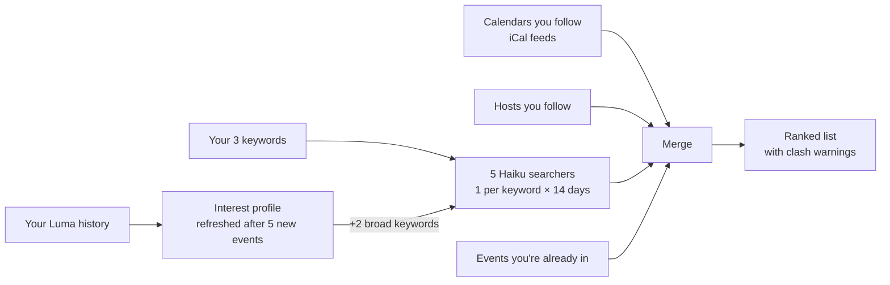

# Luma Event Scout

A Claude Code plugin that tells you which upcoming [Luma](https://luma.com) events in your city you
should go to over the next two weeks. It learns what you like from the events you've already signed
up for, adds your own keywords, and watches the calendars and hosts you follow. Setup happens once;
after that you just ask "what's on?".

It never registers you for anything. You get a date-sorted list with links and register on Luma
yourself.

```
London · 3 keywords + 2 generated · 2 calendars · 1 host. Say "change" to edit.

Wed 11 Nov  18:00  Agents Build Night            fits: you go to hands-on agent meetups
                   luma.com/xxxx                 ⚠ clashes with Fintech Drinks
Sat 14 Nov  10:00  Founders Breakfast            from a calendar you follow
                   luma.com/yyyy                 sold out (waitlist may be open)
```

## How it works



- **Discovery:** each of your 5 keywords (your 3 plus 2 broad ones taken from your profile) is
  searched once per day for the next 14 days, by small Haiku sub-agents running in parallel.
- **Followed calendars and hosts:** read from Luma's public iCal feeds and host pages by a Python
  script, so they cost no tokens.
- **Memory:** your settings and profile live in one file. The profile is only rebuilt from the few
  new events you've joined since last time, never from your whole history again.

## Install

1. In Claude Code, add the marketplace and install the plugin:

   ```
   /plugin marketplace add siarkonyar/zsk-luma-event-scout
   /plugin install luma-event-scout@zsk-luma-event-scout
   ```

2. Sign in to Luma once: run `/mcp`, pick `plugin:luma-event-scout:luma`, and authorize. No Luma Plus
   or API key is needed. The plugin brings its own Luma connection, so do this even if you already
   connected Luma elsewhere.
3. Ask Claude something like "find me Luma events this week". The first run asks for your city,
   3 keywords, and (optionally) links to calendars (`luma.com/<calendar>`) and hosts
   (`luma.com/user/<name>`) you follow.

Requires Python 3.9 or newer (`python3`). Claude Code will ask permission to run
`scripts/scout.py` and to write files under `~/.cache/luma-event-scout/run/`.

## Privacy

- **Saved** in `~/.config/luma-event-scout/state.json` (readable only by you): your city and its
  map box, your 3 keywords, links and IDs of the calendars and hosts you follow, your interest
  profile (a short summary and weighted topics), and the IDs of past events already profiled.
- **Never saved:** addresses, coordinates of events, guest lists, emails, or your registrations.
- **Per-run files** in `~/.cache/luma-event-scout/run/` hold that run's search results and are
  replaced on the next run.
- The skill only uses Luma's read tools (`list_events`, `get_event`, `search_events`,
  `lookup_entity`, `get_self`). It can't create, change or register for events.

## Cost

About 70 small searches per run (5 keywords × 14 days) on Haiku, plus a few calls on your main
model to rank the results. A profile refresh adds one lookup per new event.

## Limits

- Luma's search returns at most 10 events per call, so very broad keywords can miss some events on
  busy days.
- The calendar iCal links and host pages are public but undocumented Luma endpoints. If Luma changes
  them, those sources are skipped (and named in the output) while search keeps working.
- Luma doesn't expose check-ins, so "events you went to" means "events you registered for".

## Development

```
python3 -m venv .venv
.venv/bin/pip install -r requirements-dev.txt
.venv/bin/pytest --cov=scout_lib
```

- `skills/luma-event-scout/SKILL.md`: the flow Claude follows.
- `skills/luma-event-scout/scripts/scout.py` and `scout_lib/`: state, feeds, merge (standard
  library only).
- `agents/`: the two Haiku sub-agents.
- `docs/`: connector findings, design, plan, and the [manual test checklist](docs/manual-checklist.md).
